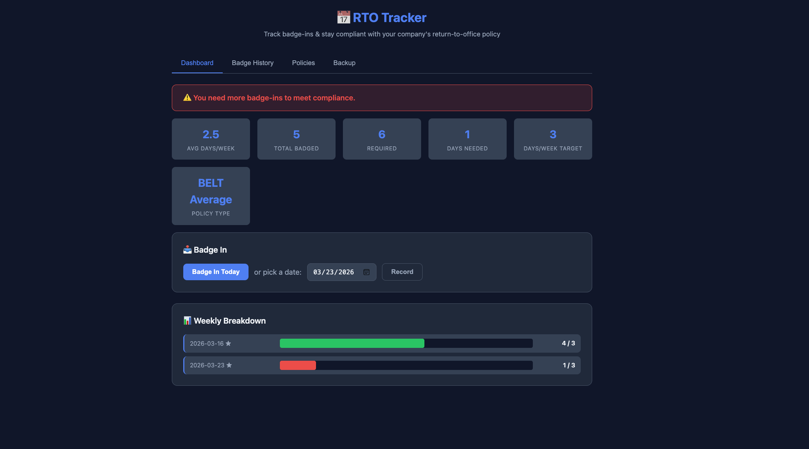
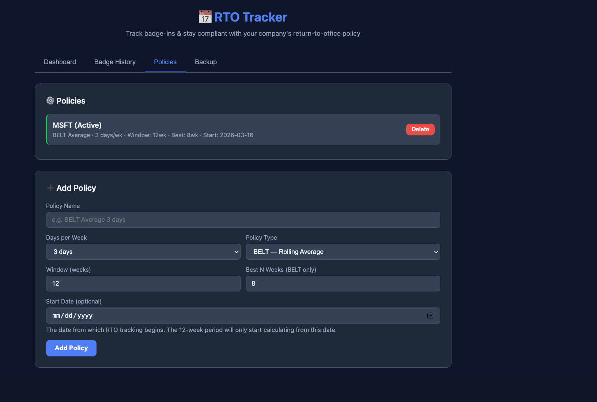

# RTO Tracker

This is a simple tool that was 100% vibe coded. Helps me with keeping track of my badge history and see if I am RTO compliant.

A lightweight, cross-platform tool for tracking your office badge-ins and staying compliant with your company's return-to-office (RTO) policy.

Launches a local web UI in your browser — no accounts, no cloud, all data stays on your machine. It does not use React but rather plain vanilla HTML, CSS, and JavaScript — a single self-contained page with zero dependencies. 

All data is stored in a SQLite database. You can export and import your data via the Backup tab to move it between machines or keep a backup.





## Features

- **One-click badge-in** for today or any past date
- **Three policy types** to match your company's rules:
  - **BELT Average** — picks the best N weeks from a rolling window and checks the average (e.g. best 8 of 12 weeks, ≥ 3 days/week average)
  - **BELT Strict** — picks the best N weeks, but each week must individually meet the target
  - **Straight** — every week in the window must meet the target
- **Configurable** — 3, 4, or 5 required days per week; adjustable window and best-week counts
- **Dashboard** — compliance status, weekly breakdown with visual bars, stats at a glance
- **Persistent storage** — SQLite database stored at `~/.rto-tracker/rto-tracker.db`
- **Cross-platform** — single binary for macOS, Windows, and Linux (no CGO)

## Getting Started

### Prerequisites

- [Go 1.25+](https://go.dev/dl/)

### Build

```sh
git clone https://github.com/your-user/rto-tracker.git
cd rto-tracker
go build -o rto-tracker .
```

### Run

```sh
./rto-tracker
```

This starts a local server and opens the UI in your default browser. Press `Ctrl+C` to stop.

### Cross-Compile

Build for other platforms from any machine:

```sh
# Windows
GOOS=windows GOARCH=amd64 go build -o rto-tracker.exe .

# Linux
GOOS=linux GOARCH=amd64 go build -o rto-tracker .

# macOS (Apple Silicon)
GOOS=darwin GOARCH=arm64 go build -o rto-tracker .
```

## Usage

1. **Badge In** — Click "Badge In Today" on the Dashboard, or pick a specific date.
2. **Check Compliance** — The dashboard shows whether you're meeting your policy, how many more days you need, and a per-week breakdown.
3. **Manage Policies** — Go to the Policies tab to add, activate, or remove policies. Only one policy is active at a time.

All policies count weeks from Sunday through Saturday. Rolling windows include the current week.

### Policy Examples

| Company Rule | Policy Type | Days/Week | Window | Best Weeks |
|---|---|---|---|---|
| Best 8 of 12 weeks, rolling average ≥ 3 days/wk | BELT Average | 3 | 12 | 8 |
| Best 8 of 12 weeks, each week must have ≥ 3 days | BELT Strict | 3 | 12 | 8 |
| 3 days every week for 12 weeks straight | Straight | 3 | 12 | — |

## Data

All data is stored locally in `~/.rto-tracker/rto-tracker.db`. Delete this file to reset everything.

## License

See [LICENSE](LICENSE).
